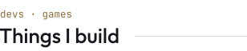
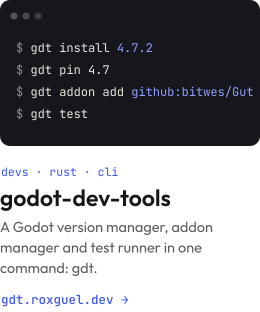
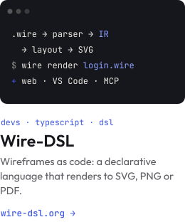
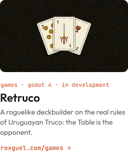
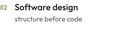

<a href="https://roxguel.com/en/">
  <picture>
    <source media="(prefers-color-scheme: dark)" srcset="assets/hero-oscuro.svg">
    
  </picture>
</a>

Team leader and software designer: I build systems with React and .NET. 
In my free time I make games on my own, from idea to launch.

<picture>
  <source media="(prefers-color-scheme: dark)" srcset="assets/stack-oscuro.svg">
  
</picture>

<picture>
  <source media="(prefers-color-scheme: dark)" srcset="assets/sec-now-oscuro.svg">
  
</picture>

<samp>work&nbsp;&nbsp;&nbsp;&nbsp;&nbsp;&nbsp;&nbsp;</samp> Team leader and software designer at Practia Uruguay 
<samp>heading to&nbsp;</samp> Software architect: I'm training to take that step 
<samp>building&nbsp;&nbsp;&nbsp;</samp> [Retruco](https://roxguel.com/en/games/truco-roguelike/), a Truco roguelike 
<samp>since&nbsp;&nbsp;&nbsp;&nbsp;&nbsp;&nbsp;</samp> Building for the web since 2012, from Montevideo, Uruguay

<picture>
  <source media="(prefers-color-scheme: dark)" srcset="assets/sec-projects-oscuro.svg">
  
</picture>

<a href="https://gdt.roxguel.dev"><picture><source media="(prefers-color-scheme: dark)" srcset="assets/p-gdt-oscuro.svg"></picture></a>
<a href="https://wire-dsl.org"><picture><source media="(prefers-color-scheme: dark)" srcset="assets/p-wire-oscuro.svg"></picture></a>
<a href="https://roxguel.com/en/games/truco-roguelike/"><picture><source media="(prefers-color-scheme: dark)" srcset="assets/p-retruco-oscuro.svg"></picture></a>

More open source on [roxguel.com/devs](https://roxguel.com/en/devs/), and every game I've released on [roxguel.com/games](https://roxguel.com/en/games/).

<picture>
  <source media="(prefers-color-scheme: dark)" srcset="assets/sec-how-oscuro.svg">
  
</picture>

<a href="https://roxguel.com/en/me/"><picture><source media="(prefers-color-scheme: dark)" srcset="assets/skill-01-oscuro.svg"></picture></a>
<a href="https://roxguel.com/en/me/"><picture><source media="(prefers-color-scheme: dark)" srcset="assets/skill-02-oscuro.svg"></picture></a>
<a href="https://roxguel.com/en/me/"><picture><source media="(prefers-color-scheme: dark)" srcset="assets/skill-03-oscuro.svg"></picture></a>
<a href="https://roxguel.com/en/me/"><picture><source media="(prefers-color-scheme: dark)" srcset="assets/skill-04-oscuro.svg"></picture></a>
<a href="https://roxguel.com/en/me/"><picture><source media="(prefers-color-scheme: dark)" srcset="assets/skill-05-oscuro.svg"></picture></a>
<a href="https://roxguel.com/en/me/"><picture><source media="(prefers-color-scheme: dark)" srcset="assets/skill-06-oscuro.svg"></picture></a>

Since 2025 I build with AI agents from specs: I write down what to build and why, and review every change before it's merged, as I would a teammate's code.

<picture>
  <source media="(prefers-color-scheme: dark)" srcset="assets/sec-contact-oscuro.svg">
  
</picture>

<samp>email&nbsp;&nbsp;&nbsp;&nbsp;</samp> [me@roxguel.com](mailto:me@roxguel.com) 
<samp>linkedin&nbsp;</samp> [in/roxguel](https://www.linkedin.com/in/roxguel) 
<samp>site&nbsp;&nbsp;&nbsp;&nbsp;&nbsp;</samp> [roxguel.com](https://roxguel.com/en/me/) · [en español](https://roxguel.com/me/) 
<samp>games&nbsp;&nbsp;&nbsp;&nbsp;</samp> [Google Play](https://play.google.com/store/apps/dev?id=4828339580704943413) · [itch.io](https://roxguel.itch.io)

 

<a href="https://roxguel.com/en/me/">
  <picture>
    <source media="(prefers-color-scheme: dark)" srcset="assets/firma-oscuro.svg">
    
  </picture>
</a>
